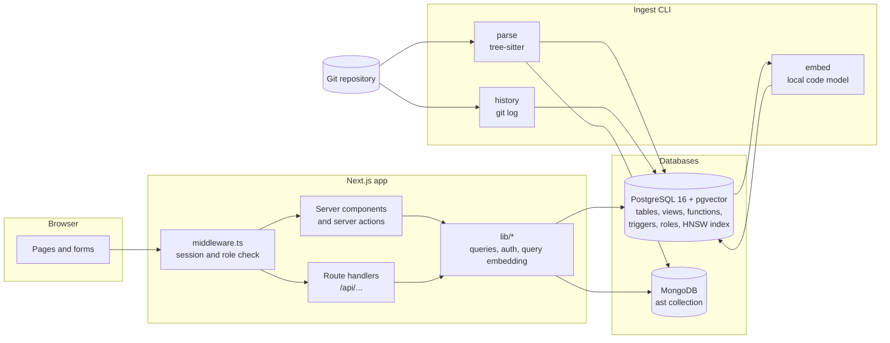
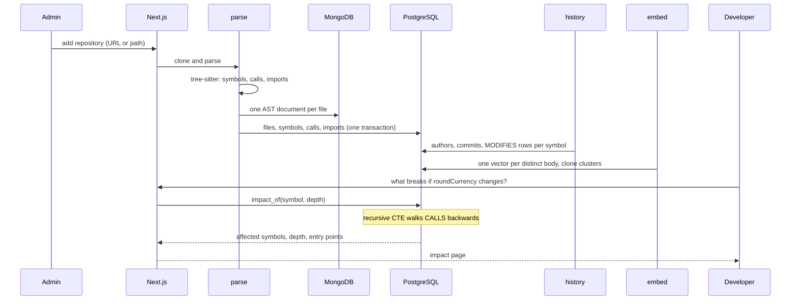

# Code Intelligence and Change Impact Analysis Engine

**Read a Git repository into a database, then ask what breaks if you change a function, who changes it, and where it is copied.**

[](package.json)
[](package.json)
[](tsconfig.json)
[](docker-compose.yml)
[](db/schema/31_vectors.sql)
[](docker-compose.yml)
[](docs/PROJECT_REPORT.md)

UE23CS351A Database Management Systems mini project, PES University, section 5 C.
Guru R Bharadwaj (PES1UG24CS177) and Vivian Sobers E (PES1UG24CS901).

The engine clones a repository and parses its JavaScript, TypeScript, Python, Java and
Go files with tree-sitter. Files, symbols, calls and imports go into PostgreSQL. Each
file's syntax tree goes into MongoDB. The Git history is mapped onto the functions each
commit changed, and every function body is embedded as a vector with pgvector. A
Next.js app with two roles, Admin and Developer, sits on top.

---

## Contents

| Section | |
|---|---|
| [What it does](#what-it-does) | The feature surface, by area |
| [Architecture](#architecture) | How the pieces fit |
| [How a repository travels](#how-a-repository-travels) | Clone, parse, store, history, embed, ask |
| [Quick start](#quick-start) | From an empty machine to a running app |
| [Project status](#project-status) | Every demo deliverable and where it lives |
| [Design decisions](#design-decisions) | The tradeoffs, and why |
| [Repository layout](#repository-layout) | Where things live |
| [Tests](#tests) | How to run each suite |
| [Documentation](#documentation) | Which file answers which question |
| [Team](#team) | Who built what |

---

## What it does

| Area | Capabilities |
|---|---|
| **Code structure** | Add a repository by URL or local path; browse its file tree, each file's symbols and their line ranges |
| **Impact analysis** | Pick a symbol and get every caller and entry point that can reach it, with call depth and the weakest link's confidence |
| **Call graph** | Callers and callees around a symbol, laid out by distance |
| **Symbol search** | Full-text search over names and signatures (`tsvector` + GIN), with camelCase and snake_case split into words |
| **AST analytics** | MongoDB aggregation pipelines: node types per language, deepest nesting per file, file size buckets |
| **History** | Commits, authors and their email addresses, and per commit which symbols changed by how many lines |
| **Hotspots and ownership** | Most-changed symbols, who owns each file, churn per author |
| **Semantic search** | Describe what code does in plain words; nearest functions by cosine distance over pgvector |
| **Clone review** | Near-duplicate functions grouped into clusters; admins confirm or dismiss them and waive members with a reason |
| **Access** | bcrypt passwords, signed session cookies, Admin and Developer roles checked in middleware, in the route, and in the database |

---

## Architecture



The browser only talks to the Next.js server. `middleware.ts` checks the session cookie
and the role rules before any page or route runs. Pages call the query functions in
`lib/` directly, and the same functions back the JSON routes under `/api`, so every
screen has an API equivalent. Database credentials come from environment variables and
never reach the browser.

---

## How a repository travels



Re-ingesting a repository keeps its `repo_id` and replaces its rows. If the Postgres
transaction fails, the MongoDB documents written during the run are removed again.

---

## Quick start

You need Node 20 or newer, Git, and Docker with Compose.

```bash
# 1 — configuration (.env is git-ignored)
cp .env.example .env
$EDITOR .env            # set SESSION_SECRET to 32+ random characters,
                        # e.g. the output of: openssl rand -base64 32

# 2 — databases: Postgres with pgvector, and MongoDB
docker compose up -d

# 3 — the app and the ingest tools
npm install
cd ingest
npm install

# 4 — load the seed repository
npm run seed                    # parse
npm run history -- seed-repo    # git log -> commits and MODIFIES
npm run embed -- seed-repo      # embeddings and clone clusters (first run downloads ~160 MB)
cd ..

# 5 — the first admin account (asks for a password of 10+ characters)
npm run user:create -- --username admin --role admin

# 6 — run it on http://localhost:3000
npm run dev
```

On its first start the Postgres container applies every `.sql` file in `db/schema`,
`db/functions`, `db/views`, `db/security` and `db/seed`, in that order. It only does this
when the data volume is new. After changing a SQL file, recreate the volume with
`docker compose down -v` (this deletes local data) or apply the file with `psql`.

For another repository run `npm run parse -- <git-url-or-path>`, then
`npm run history -- <name>` and `npm run embed -- <name>`. See
[ingest/README.md](ingest/README.md).

> **MongoDB Atlas.** `MONGODB_URI` can point at an Atlas cluster instead of the local
> container, for example `mongodb+srv://<user>:<password>@<cluster>.mongodb.net`. Apply
> the `ast` collection's validator and indexes there with the mongosh inside the local
> container:
>
> ```bash
> docker compose exec -T mongo mongosh "$MONGODB_URI" /cie-db/mongo/init/10_ast.js
> ```

For a production build use `npm run build` and then `npm start`.

---

## Project status

Every deliverable on the mini project demo list is built and has a file to point at.

| # | Deliverable | Status | Evidence |
|---|---|:---:|---|
| 1 | ER diagram | ✅ | [docs/ER_Relational_Schema.pdf](docs/ER_Relational_Schema.pdf), [DATABASE_DESIGN.md](docs/DATABASE_DESIGN.md#er-model) |
| 2 | Relational schema with keys, relationships and constraints | ✅ | [docs/ER_Relational_Schema.pdf](docs/ER_Relational_Schema.pdf), [mapping and BCNF](docs/DATABASE_DESIGN.md#mapping-to-relations) |
| 3 | SQL implementation: DDL with constraints | ✅ | [db/schema/](db/schema/) — 13 tables, CHECK, UNIQUE, composite and recursive foreign keys |
| 4 | NoSQL and vector database creation | ✅ | [db/mongo/init/10_ast.js](db/mongo/init/10_ast.js), [db/schema/31_vectors.sql](db/schema/31_vectors.sql) |
| 5 | Technology justification | ✅ | [DATABASE_DESIGN.md](docs/DATABASE_DESIGN.md#why-three-kinds-of-storage) |
| 6 | DML operations | ✅ | [db/queries/dml_operations.sql](db/queries/dml_operations.sql) |
| 7 | Nested, correlated, recursive and join queries | ✅ | [db/queries/query_types.sql](db/queries/query_types.sql), [STRUCTURE_QUERIES.md](docs/STRUCTURE_QUERIES.md), [HISTORY_QUERIES.md](docs/HISTORY_QUERIES.md) |
| 8 | Procedures and functions, triggers, CTEs | ✅ | [db/functions/](db/functions/), [db/views/](db/views/) |
| 9 | NoSQL and vector features, read/update/delete | ✅ | [db/mongo/pipelines.js](db/mongo/pipelines.js), [db/mongo/rud.js](db/mongo/rud.js), [db/queries/vector_operations.sql](db/queries/vector_operations.sql) |
| 10 | Next.js interface | ✅ | [app/](app/), [screenshots](docs/STRUCTURE_SCREENSHOTS.md) |
| 11 | Backend API and database integration | ✅ | [app/api/](app/api/), [lib/](lib/) |
| 12 | Authentication: frontend, two roles, RBAC in the database | ✅ | [lib/auth/](lib/auth/), [middleware.ts](middleware.ts), [db/security/40_roles.sql](db/security/40_roles.sql) |
| 13 | Documentation and Git/GitHub | ✅ | [docs/](docs/), branches and pull requests per feature |
| 14 | Originality, individual contribution | ✅ | [WORK_SPLIT.md](docs/WORK_SPLIT.md), commit history per author |

The full write-up is [docs/PROJECT_REPORT.md](docs/PROJECT_REPORT.md).

### What the tests prove

| Suite | Proves |
|---|---|
| `npm test` | 65 unit tests: access rules, sessions, bcrypt, login throttling, parameter parsing, DB client setup, impact workflow layout |
| `npm run typecheck` | The app type-checks under strict TypeScript |
| `db/tests/run.sh` | 8 SQL test files in a scratch database: `impact_of`, symbol search, span triggers, history schema, vectors, views, clone review, and the database roles |
| `cd ingest && npm test` | 84 tests: extraction for five languages, call and import resolution, git log parsing, author merging, embedding and clustering, full ingests against real databases |
| `tests/structure`, `tests/history` | API smoke tests against a running app, signed in |

On Windows the ingest suite's `BlobReader` group reports a failure after all its tests
pass. Its teardown cannot delete a temporary directory while a `git cat-file` process
still holds it. Linux and macOS are not affected.

---

## Design decisions

**PostgreSQL for code structure, and the graph walk inside it.** Repositories, files,
symbols, calls and imports are rows linked by foreign keys. Impact analysis is a
recursive CTE over `calls` inside the stored function `impact_of`. The traversal runs
next to the data, and depth and confidence are computed in one query.

**MongoDB for syntax trees.** A file's AST is a deep tree whose node types differ by
language. It is stored as one document per file, flattened into an array of nodes, with
a `$jsonSchema` validator and a unique `(repo_id, path)` index. Aggregation pipelines
answer the per-language questions.

**pgvector inside Postgres, not a separate vector store.** Embeddings sit next to the
symbols they describe. Semantic search filters by repository with an ordinary join, and
deleting a vector unlinks its symbols through a foreign key. An HNSW index serves the
cosine-distance searches.

**Roles are checked in three places.** `middleware.ts` rejects a request before any page
runs. The route or server action checks the signed-in user again. The database checks a
third time: a trigger refuses a clone review recorded by a non-admin, and the
`cie_developer` and `cie_admin` roles limit what any connection under either role can
read or write. A bug in one layer does not open the data.

**A local embedding model.** `jinaai/jina-embeddings-v2-base-code` runs on the CPU, for
ingestion and for search queries. No source code leaves the machine.

**One transaction per ingest.** A repository's files, symbols, calls and imports are
written in a single Postgres transaction. A failed parse leaves the previous version in
place instead of half a repository.

---

## Repository layout

```
.
├── app/            Next.js App Router: pages, server actions, /api route handlers
├── components/     React components for structure, history, clones and auth
├── lib/            Database queries, auth, sessions, query embedding
├── middleware.ts   Session and role check on every request
├── db/
│   ├── schema/     DDL: tables, constraints, indexes, pgvector
│   ├── functions/  Stored functions, the review procedure, triggers
│   ├── views/      Hotspot, ownership and author activity views
│   ├── security/   Database roles and grants
│   ├── seed/       Seed data
│   ├── queries/    Demo queries: DML, query kinds, vectors, feature queries
│   ├── mongo/      ast validator, indexes, pipelines, read/update/delete script
│   ├── tests/      SQL tests run in a scratch database
│   └── init/       Container start-up script that applies the SQL
├── ingest/
│   ├── parse/      Clone and tree-sitter parse -> PostgreSQL and MongoDB
│   ├── history/    git log -> authors, commits, MODIFIES
│   └── embed/      Symbol embeddings and clone clustering
├── scripts/        create-user
├── tests/          Unit tests and API smoke tests
└── docs/           Report, design, queries, test results, screenshots
```

---

## Tests

```sh
npm test                                  # app unit tests
npm run typecheck                         # app type check
cd ingest && npm test                     # parser, history and embedding tests
docker compose exec -T postgres sh /cie-db/tests/run.sh   # SQL tests in a scratch database
CIE_TEST_USERNAME=admin CIE_TEST_PASSWORD=... node --test tests/structure/api.test.mjs  # Structure API smoke test
CIE_TEST_USERNAME=ana CIE_TEST_PASSWORD=... node --test tests/history/api.test.mjs      # History & clones API smoke test
```

---

## Documentation

| Question | File |
|---|---|
| *What is the whole project, in report form?* | [docs/PROJECT_REPORT.md](docs/PROJECT_REPORT.md), [PDF](docs/PROJECT_REPORT.pdf) |
| *What problem does it solve, and what is in scope?* | [docs/PROJECT_OVERVIEW.md](docs/PROJECT_OVERVIEW.md) |
| *What does the ER diagram look like?* | [docs/ER_Relational_Schema.pdf](docs/ER_Relational_Schema.pdf) |
| *How does the ER model map to tables, and why three stores?* | [docs/DATABASE_DESIGN.md](docs/DATABASE_DESIGN.md) |
| *How are ASTs stored and queried?* | [docs/MONGODB_AST.md](docs/MONGODB_AST.md) |
| *Where are the DML, query kinds, vector and Mongo operations, and roles?* | [docs/DATABASE_OPERATIONS.md](docs/DATABASE_OPERATIONS.md) |
| *Which code structure queries matter?* | [docs/STRUCTURE_QUERIES.md](docs/STRUCTURE_QUERIES.md) |
| *Which history, similarity and access queries matter?* | [docs/HISTORY_QUERIES.md](docs/HISTORY_QUERIES.md) |
| *Did the tests pass?* | [docs/STRUCTURE_TEST_RESULTS.md](docs/STRUCTURE_TEST_RESULTS.md), [docs/HISTORY_TEST_RESULTS.md](docs/HISTORY_TEST_RESULTS.md) |
| *What does the app look like?* | [docs/STRUCTURE_SCREENSHOTS.md](docs/STRUCTURE_SCREENSHOTS.md), [docs/HISTORY_SCREENSHOTS.md](docs/HISTORY_SCREENSHOTS.md) |
| *How do I ingest another repository?* | [ingest/README.md](ingest/README.md) |
| *Who did what?* | [docs/WORK_SPLIT.md](docs/WORK_SPLIT.md) |

---

## Team

| Member | SRN | Focus |
|---|---|---|
| **Guru R Bharadwaj** | PES1UG24CS177 | Code structure and impact analysis: what is in a repository, who calls what, and what breaks when something changes |
| **Vivian Sobers E** | PES1UG24CS901 | History, similarity and access: who changed what, which code is duplicated, and who may see and review it |

Section 5 C. The work is split by feature, top to bottom. Each person owns their tables,
the SQL, NoSQL and vector code behind them, the API routes and the pages that use them.
See [docs/WORK_SPLIT.md](docs/WORK_SPLIT.md).
