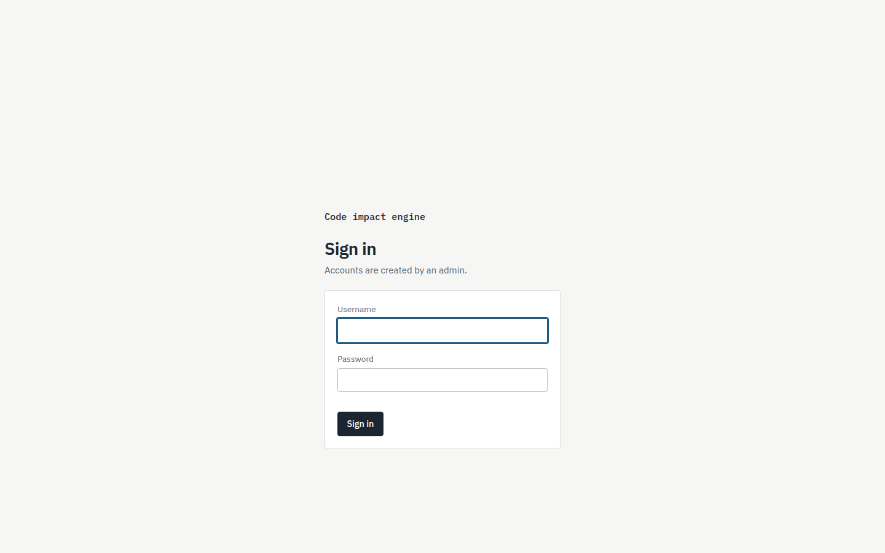
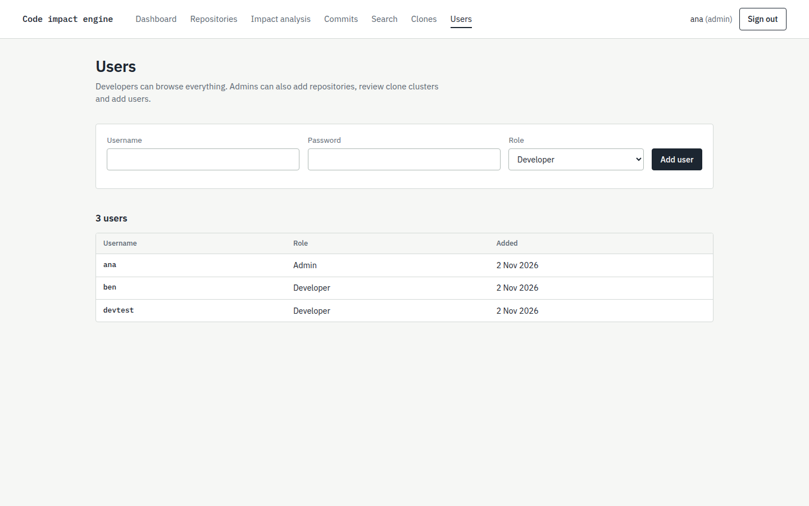
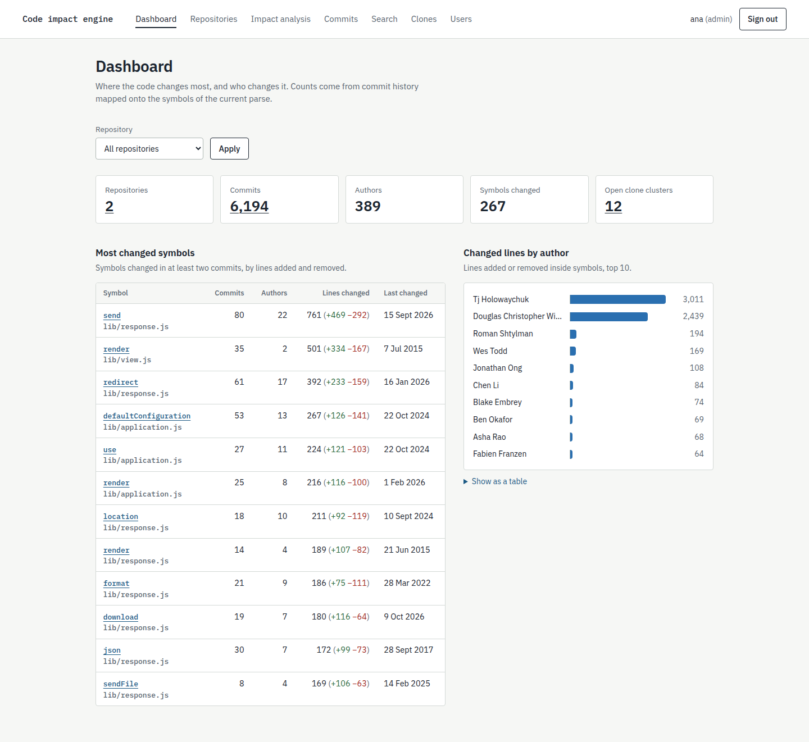
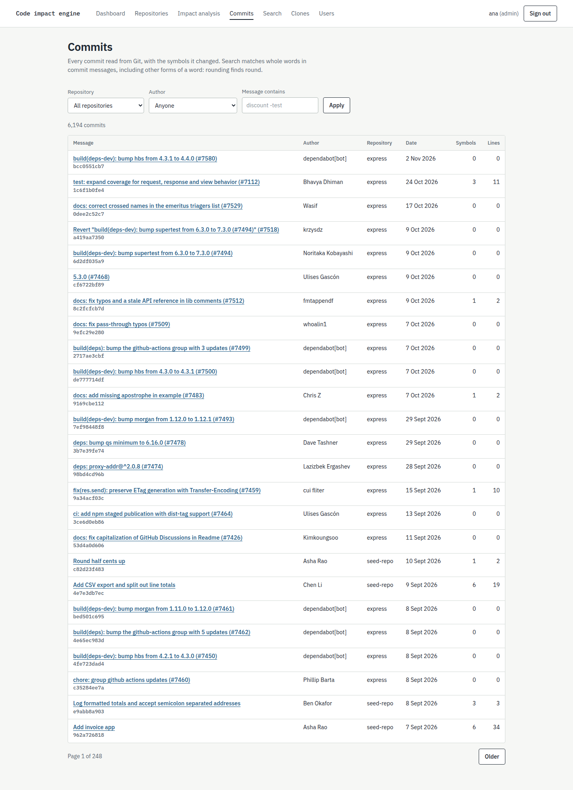
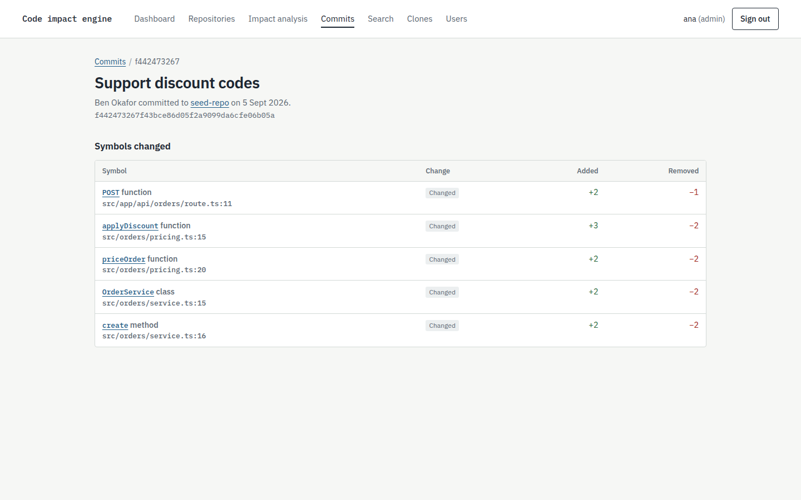
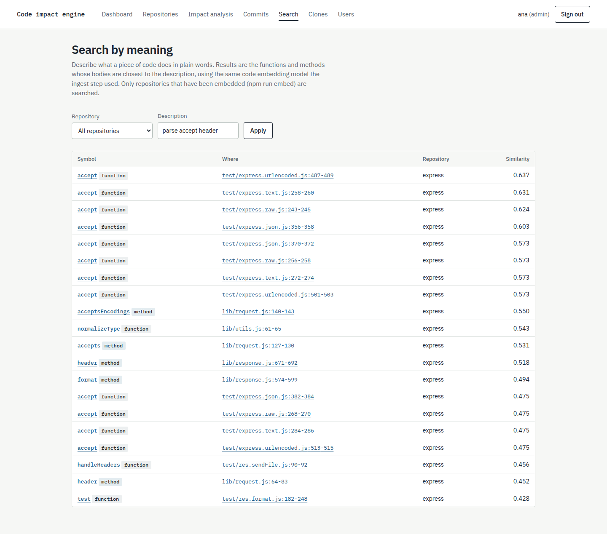
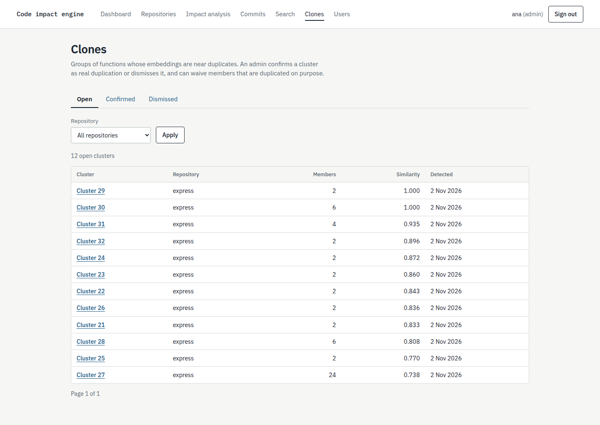
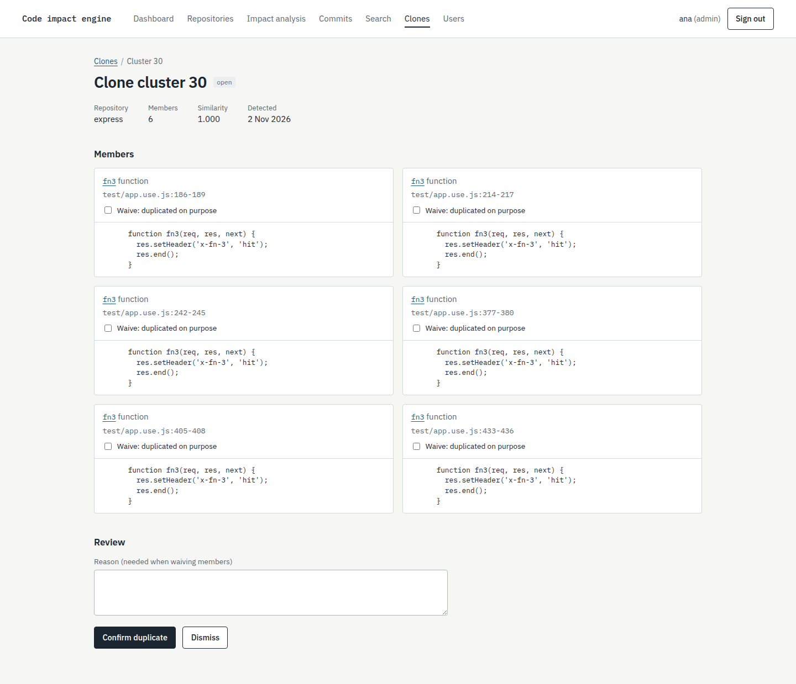

# History, similarity and access screenshots

These pages run on real ingested data from the seed repo and expressjs/express. They were captured in Chrome at a 1440 by 900 viewport. [tests/history/screenshots.mjs](../tests/history/screenshots.mjs) retakes them.

## Authentication and administration

The sign-in page enforcing username, password, session cookies, and brute-force throttling.

The admin user management page where administrators create accounts and assign roles (`admin` or `developer`).

## History dashboard

The history dashboard overview displaying high-level repository totals, change hotspots (`v_symbol_hotspot`), and lines changed per author with interactive filtering by repository.

## Commit history

The commit history page listing commits newest first, with author attribution, changed symbol counts, net churn, repository filtering, and full-text search with English stemming.

The commit detail view showing the exact symbols added or modified by the commit diff, line ranges, and additions/deletions.

## Semantic code search

Semantic search ranking functions and methods by meaning using the 768-dimensional local code embedding model and pgvector cosine distance against the user's natural language query.

## Clone review and waivers

The clone review queue displaying detected near-duplicate clusters filtered by status (`open`, `confirmed`, `dismissed`) and repository.

The clone cluster review page showing member symbol line comparisons, source code snippets from repository checkouts, and admin review actions to confirm or dismiss clusters and record per-symbol waivers with reasons.

