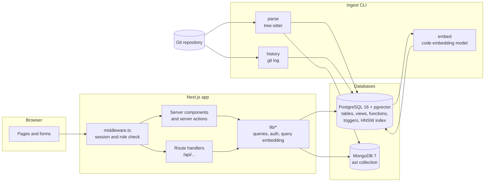

# Project overview

Code Intelligence and Change Impact Analysis Engine. Guru R Bharadwaj (PES1UG24CS177) and Vivian Sobers E (PES1UG24CS901), section 5 C.

## Problem statement

A developer about to change a function in an unfamiliar codebase has to answer a few questions before they touch it. What calls this function, directly or through other functions? Which entry points (routes, CLI commands, `main`) end up running it? Who changed it recently, and how often does it change? Is the same logic copied somewhere else, so that a fix here also needs a fix there?

Git and an editor answer each of these slowly and separately. `git log` lists commits but not which functions they touched. Text search finds names but not callers through two levels of indirection, and it cannot find code that does the same thing under a different name.

This project reads a Git repository into a database and answers those questions from it. Code structure (files, symbols, calls, imports) goes into PostgreSQL. Each file's syntax tree goes into MongoDB. Commit history is mapped onto the symbols each commit changed. Function bodies are embedded as vectors with pgvector, so the app can find duplicated code and search by meaning.

## Objectives

1. Parse JavaScript, TypeScript, Python, Java and Go repositories into a relational model of files, symbols, calls and imports, with the full syntax tree of each file kept as a MongoDB document.
2. Given a symbol, list every symbol and entry point that can reach it through the call graph, with a recursive query inside the database.
3. Read the whole Git history of a repository and record, for each commit, which symbols it added or modified and by how many lines.
4. Show change hotspots, per-file ownership and per-author churn from views over that history.
5. Embed every function and method body with a local code embedding model, search them with a plain-language description, and group near-duplicates into clone clusters that an admin reviews.
6. Put all of this behind a Next.js web app with two roles, Admin and Developer, enforced both in the app and in the database.

## Scope

In scope:

- Repositories reachable by `git clone` (public HTTPS or SSH URLs) and local folders.
- Source files in the five languages above. Other files are listed but not parsed.
- Calls are resolved by name within the repository, with a confidence score. A call through a variable or a dynamic import may be missed or resolved to the wrong function; the score records how sure the resolver was.
- History on every branch, oldest commit first. Merge commits are recorded but their diffs are not counted again, because the changes are already counted on the commits that made them.
- One embedding model, `jinaai/jina-embeddings-v2-base-code`, run locally on the CPU. No code leaves the machine.
- Two roles. Developers can read everything. Admins can also add repositories, review clone clusters and manage users.

Out of scope:

- Type-aware call resolution (for example, which of two `save` methods a call reaches through an interface).
- Runtime information such as coverage or profiling data.
- Watching a repository for new commits. Ingestion is re-run by hand.
- Self-service sign-up and password reset. An admin creates every account.
- Hosting. The app runs locally against Docker Compose databases.

## Functional requirements

| ID | Requirement | Owner |
|---|---|---|
| FR1 | An admin adds a repository by URL or local path; the app clones it, parses it and stores files, symbols, calls and imports in one transaction. | Guru |
| FR2 | Users browse a repository's files and see each file's symbols with their line ranges. | Guru |
| FR3 | Users open a symbol and see its callers, its callees and a call graph around it. | Guru |
| FR4 | Users pick a symbol and get its impact set: every symbol and entry point that can reach it, with the call depth. | Guru |
| FR5 | Users search symbols by name and signature (full-text search). | Guru |
| FR6 | A repository page shows node-type counts per language and the most deeply nested files, computed by MongoDB aggregation pipelines over the stored syntax trees. | Guru |
| FR7 | The history step reads `git log` and stores authors, their email addresses, commits, and one row per (commit, symbol) with added and deleted lines. | Vivian |
| FR8 | The dashboard shows totals, the symbols changed most often (hotspots) and lines changed per author, filterable by repository. | Vivian |
| FR9 | Users list commits newest first, filter by repository and author, search commit messages, and open a commit to see the symbols it changed. | Vivian |
| FR10 | Users describe what code does in plain words and get the closest functions and methods, ranked by cosine similarity. | Vivian |
| FR11 | The embed step groups near-duplicate functions into clone clusters. Admins confirm or dismiss each cluster and can waive individual members with a reason; developers see the queue read-only. | Vivian |
| FR12 | Users sign in with a username and password. Admins create users and choose their role. Pages and API routes enforce the role rules in the table below. | Vivian |

## System architecture

The browser only talks to the Next.js server. `middleware.ts` checks the session cookie on every request and applies the role rules before any page or route runs. Pages are server components that call the query functions in `lib/` directly; the same functions back the JSON routes under `/api`, so every screen has an API equivalent. Database credentials come from environment variables (`DATABASE_URL`, `MONGODB_URI`, `SESSION_SECRET`) and never reach the browser.

Ingestion runs from the command line in three steps, each re-runnable:

1. `npm run parse` clones the repository, parses every supported file with tree-sitter, writes each syntax tree to MongoDB and the files, symbols, calls and imports to PostgreSQL.
2. `npm run history` reads the full `git log` with zero-context patches, re-parses each changed file at the old and new revision, and attributes added and deleted lines to the symbols whose line ranges they fall in.
3. `npm run embed` embeds each function and method body, stores one vector per distinct body, links symbols to their vectors and rebuilds the open clone clusters.

The search page embeds the user's description with the same model in the app server and asks PostgreSQL for the nearest vectors by cosine distance. Clone reviews go through the stored procedure `review_clone_cluster`, which locks the cluster row, checks the reviewer and records waivers in one transaction.

## Roles and access

Every account is either an Admin or a Developer. The role is stored in `app_user.role` and copied into the signed session cookie at sign-in.

| Action | Signed out | Developer | Admin |
|---|---|---|---|
| Sign in | yes | yes | yes |
| View dashboard, repositories, files, symbols, impact, commits, search | no (sent to the sign-in page; API returns 401) | yes | yes |
| View clone queue and clusters | no | yes | yes |
| Add a repository | no | no (403) | yes |
| Confirm or dismiss a clone cluster, waive members | no | no (403) | yes |
| Create users | no | no (403) | yes |

The rules are enforced in three places. `middleware.ts` rejects the request before it reaches a page or route. The route or server action checks the signed-in user again. For clone reviews the database checks a third time: the trigger on `clone_cluster` raises SQLSTATE 42501 unless the reviewer's `app_user.role` is `admin`, so a bug in the app cannot record a review by a developer.

Passwords are stored as bcrypt hashes with cost 12, and a CHECK constraint rejects anything in `password_hash` that is not a bcrypt hash. After five failed sign-ins for one username within ten minutes, further attempts are refused until the window passes.
