# Code structure screenshots

These pages run on real ingested data: the seed repo, psf/requests, expressjs/express and sindresorhus/slugify. They were captured in Microsoft Edge at a 1440 by 900 viewport. [tests/structure/screenshots.mjs](../tests/structure/screenshots.mjs) retakes them.

## Repositories

The repository list with each repository's languages and counts.

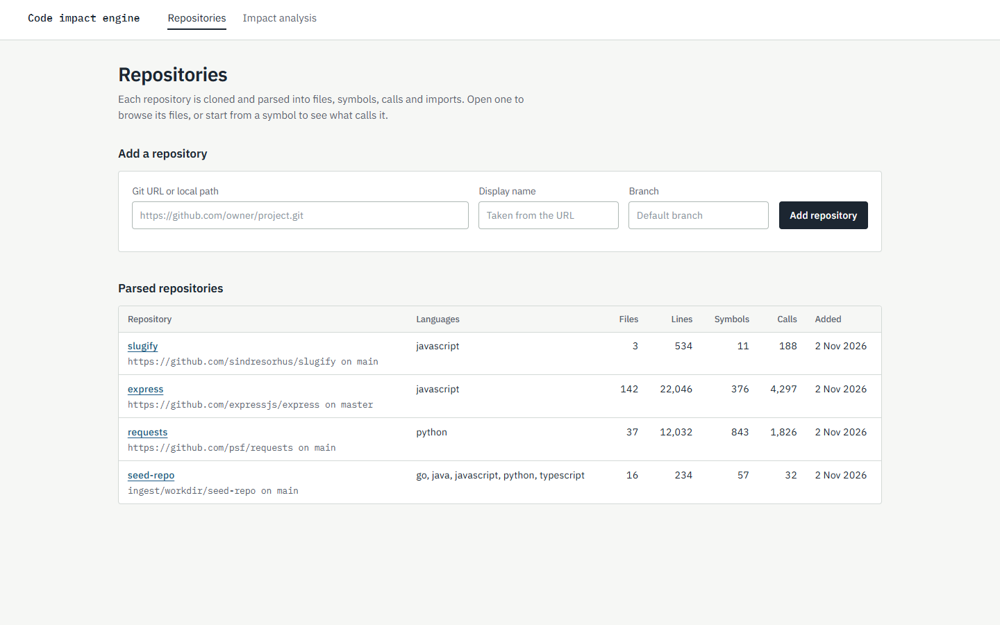

The add-repository form while a repository is being cloned and parsed.

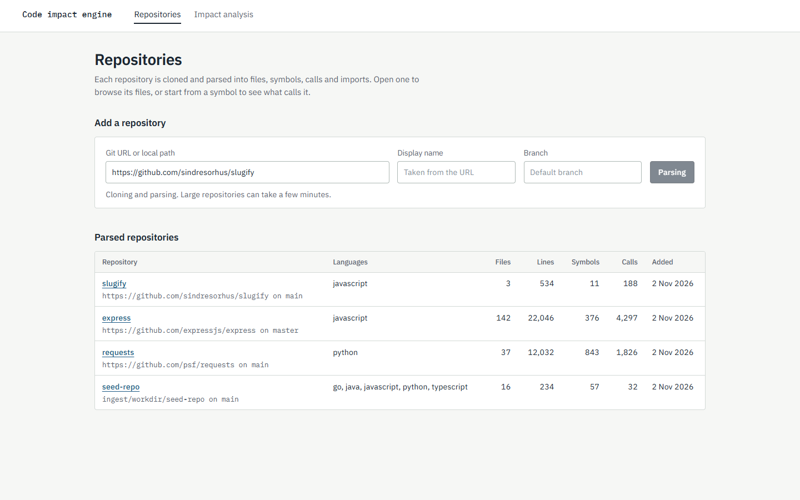

The same form after the parse finishes, with a summary of what was stored.

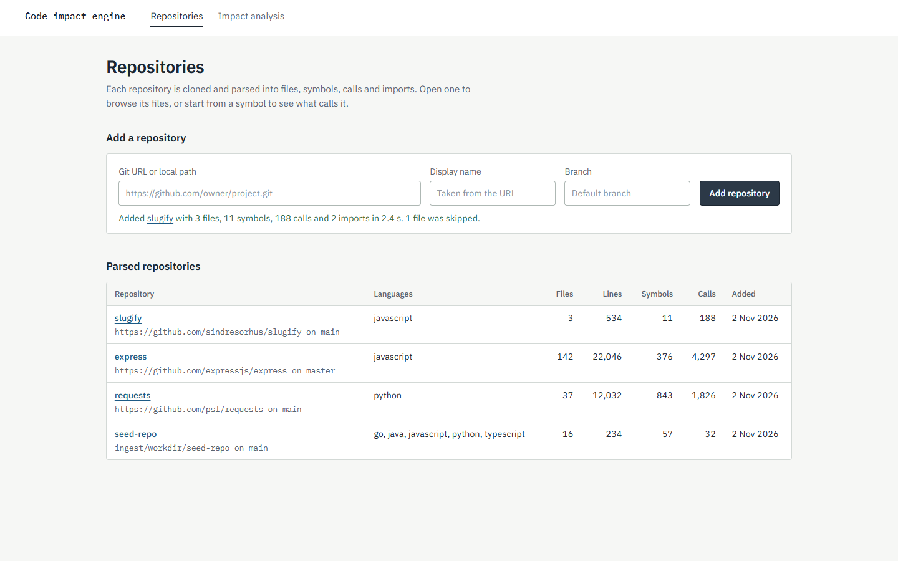

The seed repo's file tree next to AST statistics from MongoDB.

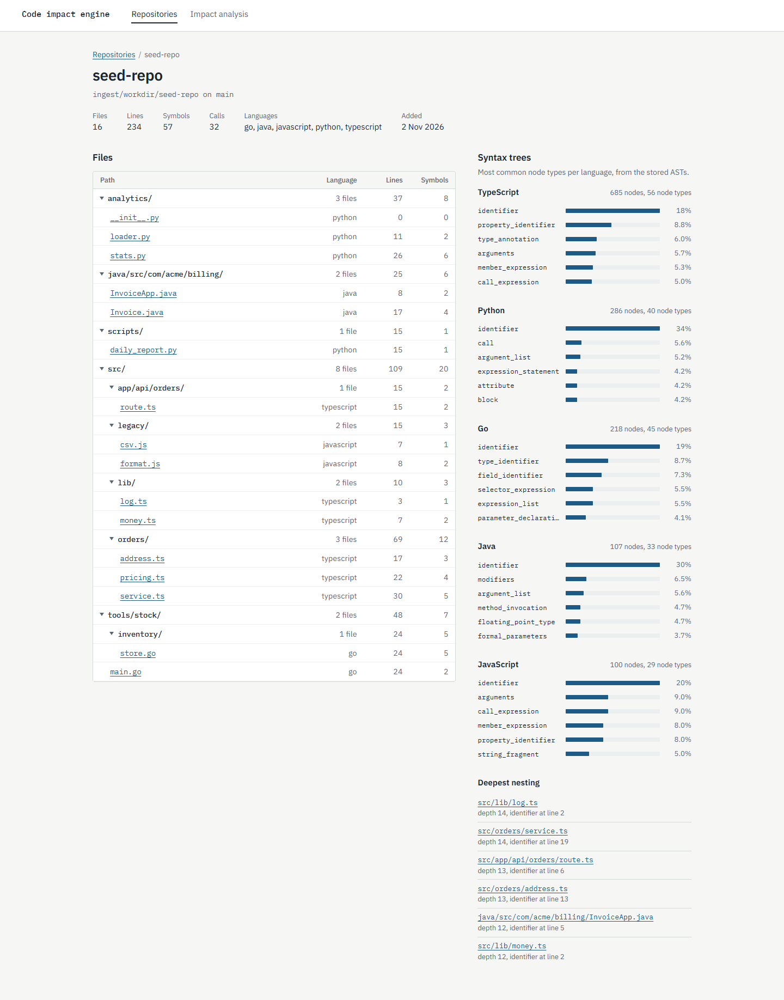

## Files and symbols

A file's declared symbols, with the files it imports and the files that import it.

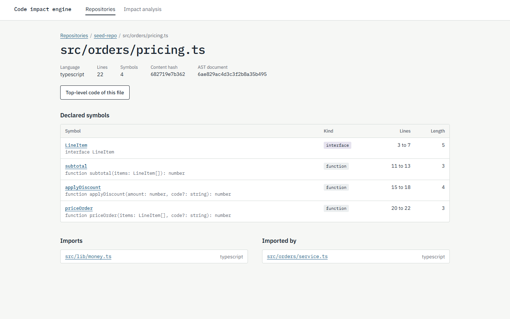

`OrderService.create` with its signature, callers and callees.

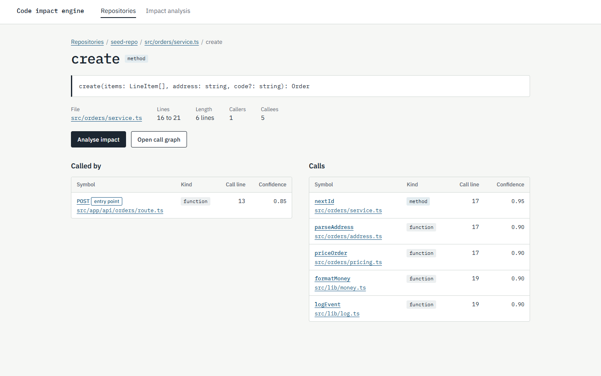

## Call graph and impact

The call graph for `priceOrder`, two steps in each direction.

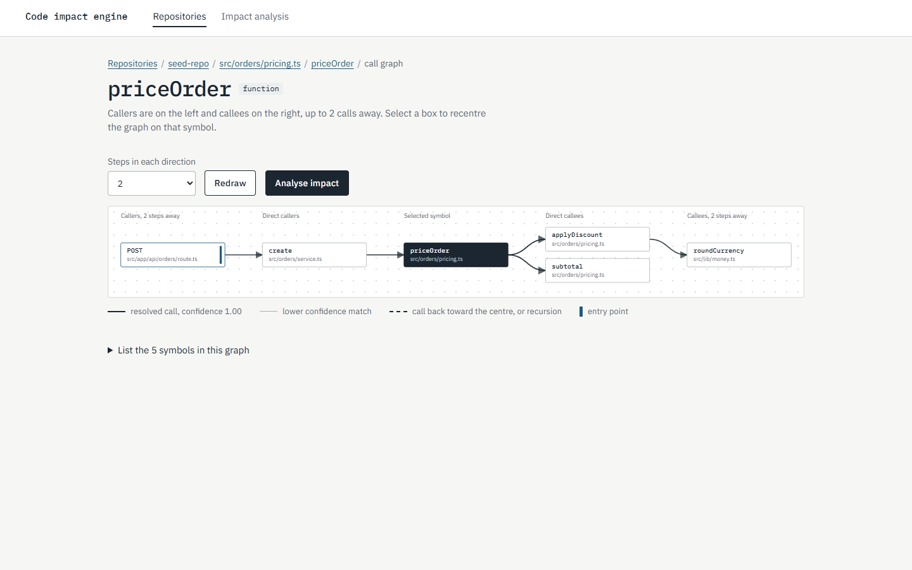

Impact of changing `roundCurrency`: five affected symbols, one entry point, and the call path to each.

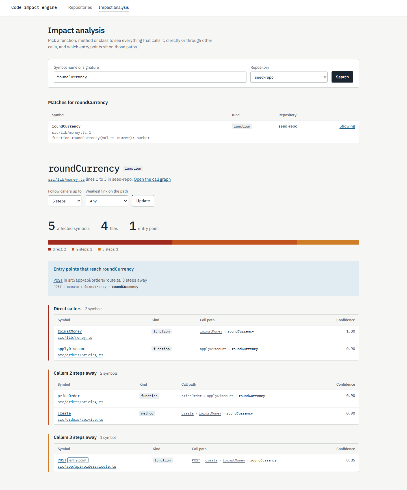

Search results for `parse` across all repositories.

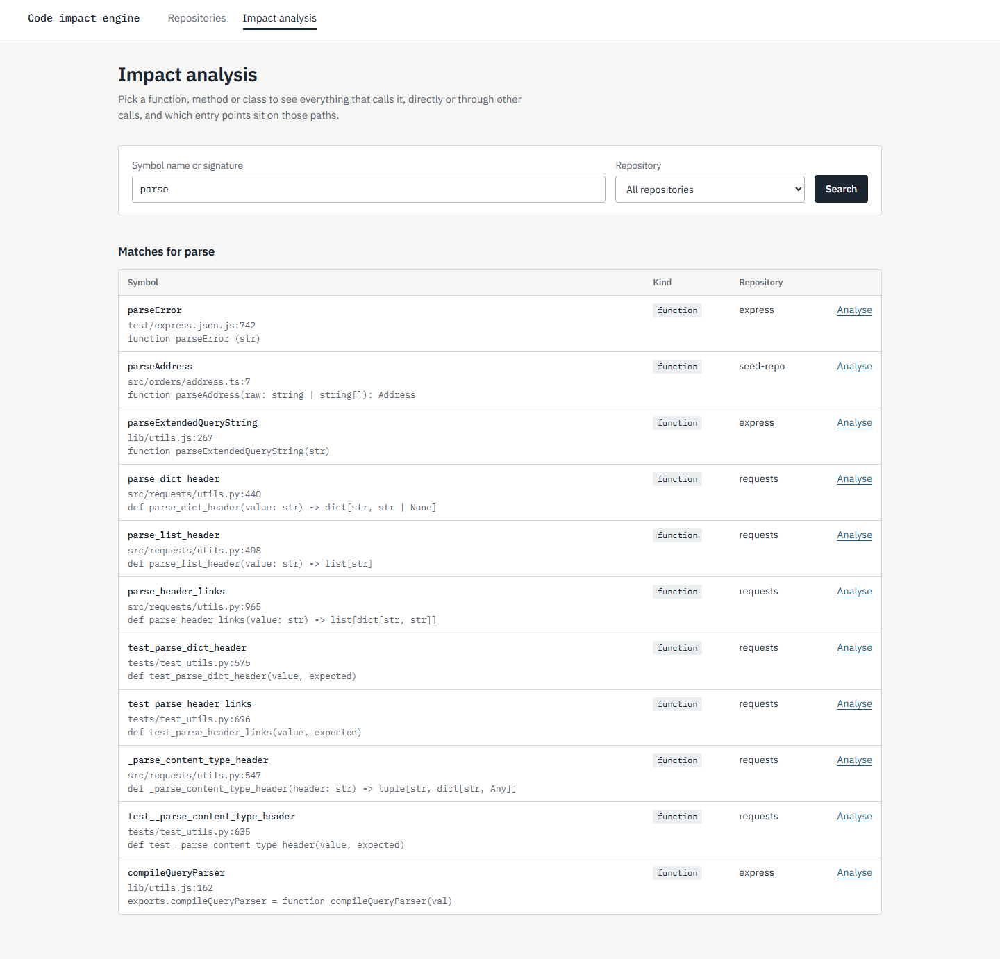

## Real repositories

The express repository page, with its 142 files and 108,201 JavaScript syntax nodes.

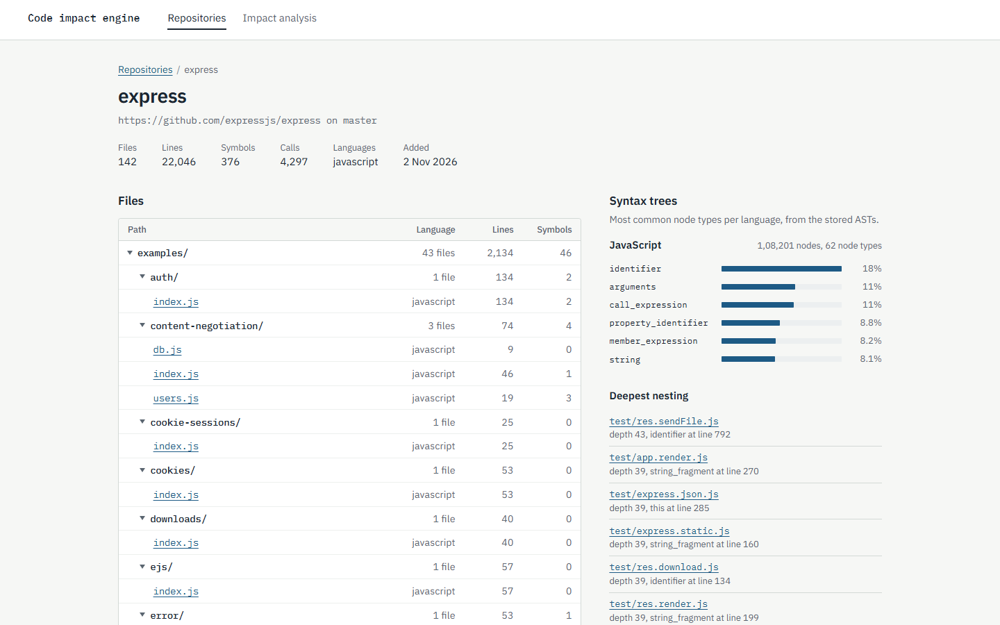

Impact of `tryRender` in express, limited to calls with confidence 0.75 or more: 21 symbols in 16 files, 15 of them entry points.

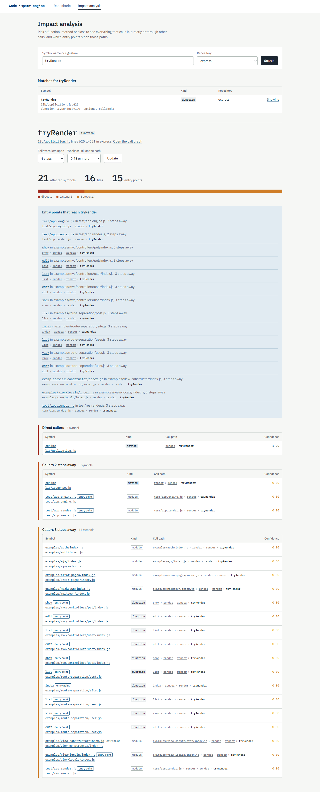

The call graph for `tryRender`. Thin lines are low confidence matches, such as the `render` functions in the test files.

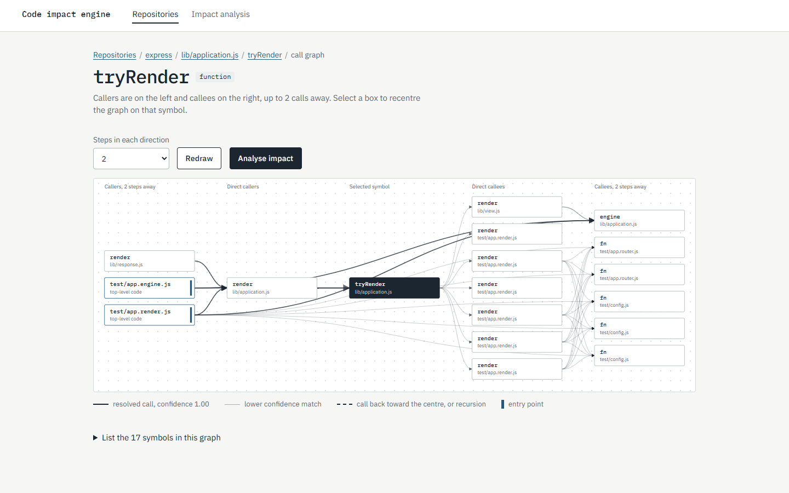
